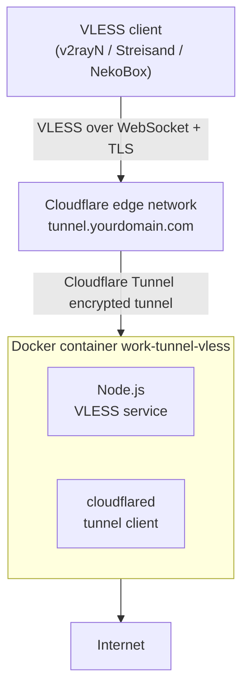

# Work Tunnel VLESS

[中文](README.md) | English

A Dockerized VLESS proxy server based on Node.js, integrated with Cloudflare Tunnel — a secure, efficient one-click proxy solution for developers.

## Architecture



## Features

- VLESS protocol support
- Automatic validation of UUID, port, and domain formats
- Environment variable configuration
- WebSocket connections
- Automatic dependency installation
- Multi-arch support: `linux/amd64` and `linux/arm64` images

## Use Cases

- Fixed-IP access: route traffic through a fixed server IP over a secure tunnel, bypassing IP-based restrictions
- Remote work: secure network access for distributed team members
- Cross-region access: bypass geo-restrictions with a stable connection
- Dev & testing: a safe sandbox for cross-region application testing
- Data sync: secure cross-region data transfer, no leaks
- Corporate intranet: secure remote access to internal resources

## Requirements

- Node.js >= 14
- npm

## Cloudflare Zero Trust Tunnel Setup

1. Log in to the Cloudflare Zero Trust dashboard
   - Go to https://dash.cloudflare.com/
   - Select "Zero Trust"

2. Create a Tunnel
   - Left menu: "Access" -> "Tunnels"
   - Click "Create a tunnel"
   - Name it (e.g. `work-tunnel-vless`)
   - Choose "Docker" as the environment
   - Copy the generated Tunnel Token

3. Configure a Public Hostname
   - On the Tunnel details page, click "Configure"
   - Go to the "Public Hostname" tab
   - Click "Add a public hostname"
   - Enter your domain (e.g. `tunnel.yourdomain.com`)
   - Service type: "HTTP"
   - URL: `http://localhost:8080` (or your VLESS service port)

4. Collect what you need
   - Tunnel Token (for authentication)
   - Domain (for access)

## One-Click Deploy (no Docker, recommended)

Runs directly on the host — no Docker required. Supports Alpine Linux, Ubuntu 20.04+, Debian 11+. Automatically installs dependencies, downloads files, creates config, and registers the service.

**wget:**
```bash
wget -qO /tmp/s.sh https://raw.githubusercontent.com/playwjj/work-tunnel-vless/main/install.sh && sh /tmp/s.sh
```

**curl:**
```bash
curl -fsSL https://raw.githubusercontent.com/playwjj/work-tunnel-vless/main/install.sh -o /tmp/s.sh && sh /tmp/s.sh
```

The script will prompt for:

| Parameter | Description | Required |
|------|------|----------|
| Install directory | Install dir name, default `work-tunnel-vless` | Optional |
| UUID | VLESS user UUID | Required |
| TUNNEL_DOMAIN | Public domain, e.g. `example.com` | Required |
| TUNNEL_TOKEN | Cloudflare Tunnel Token | Required |
| PORT | Listen port, default `3000` | Optional |
| NAME | Node name, defaults to system hostname | Optional |

After deployment the service auto-registers and starts on boot. Common commands:

```bash
# Alpine (OpenRC)
rc-service work-tunnel-vless restart
rc-service cloudflared restart
tail -f /var/log/work-tunnel-vless.log

# Ubuntu/Debian (systemd)
systemctl restart work-tunnel-vless
systemctl restart cloudflared
journalctl -fu work-tunnel-vless
```

> If a `.env` file already exists the script skips creating it — re-running updates the code. To change config, edit `.env` manually and restart the service.

---

## Install Steps

1. Clone the repo:
```bash
git clone https://github.com/playwjj/work-tunnel-vless.git
cd work-tunnel-vless
```

2. Install dependencies:
```bash
npm install
```

3. Configure environment variables:
```bash
cp .env.sample .env
```
Then edit `.env` with your values.

### Run with Docker

1. Use the Docker Hub image directly:
```bash
docker run -d \
  --name work-tunnel-vless \
  --env-file .env \
  --log-opt max-size=10m \
  --log-opt max-file=3 \
  passport888/work-tunnel-vless:latest
```

2. Or build from source:
```bash
# Single-arch build (current platform)
docker build -t work-tunnel-vless .
docker run -d \
  --name work-tunnel-vless \
  --env-file .env \
  --log-opt max-size=10m \
  --log-opt max-file=3 \
  work-tunnel-vless

# Multi-arch build (requires Docker buildx)
docker buildx build \
  --platform linux/amd64,linux/arm64 \
  -t work-tunnel-vless:latest \
  --push .
```

### Docker Compose

1. Create `docker-compose.yml`:
```yaml
version: '3'
services:
  work-tunnel-vless:
    image: passport888/work-tunnel-vless:latest
    container_name: work-tunnel-vless
    env_file:
      - .env
    restart: unless-stopped
    logging:
      driver: "json-file"
      options:
        max-size: "10m"
        max-file: "3"
```

2. Start:
```bash
docker-compose up -d
```

## Configuration

Required environment variables:
- `UUID`: VLESS protocol UUID
- `PORT`: server listen port
- `TUNNEL_DOMAIN`: server domain
- `TUNNEL_TOKEN`: Cloudflare Tunnel auth token

Optional:
- `NAME`: server name (defaults to hostname)
- `TUNNEL_FORCE_IP_VERSION`: force IP version for Cloudflare edge connections, `6` forces IPv6
- `TUNNEL_TRANSPORT_PROTOCOL`: cloudflared transport protocol (`quic`, `http2`, etc.)
- `MAX_MEMORY_USAGE`: max heap in bytes before auto-exit, default 536870912 (512MB)

## Usage

1. Start the server:
```bash
npm start
```

2. Get your VLESS link at:
- VLESS link: `https://[TUNNEL_DOMAIN]/[UUID]`

## Notes

- Make sure the firewall allows the relevant ports
- HTTPS and WSS are recommended
- Keep your UUID private — don't share it

## License

MIT

---

⭐ If this project helps you, please give it a Star!
